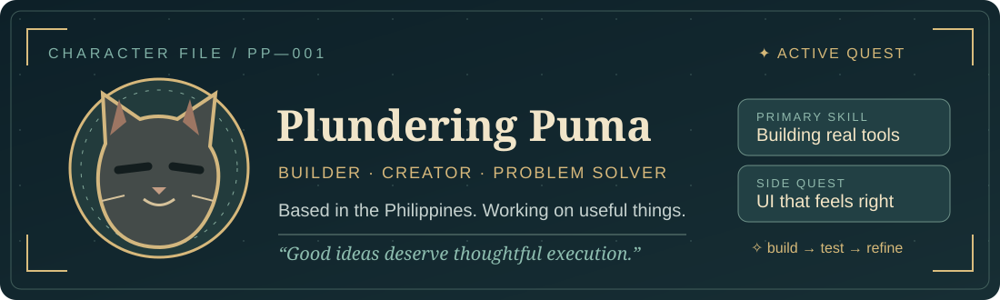
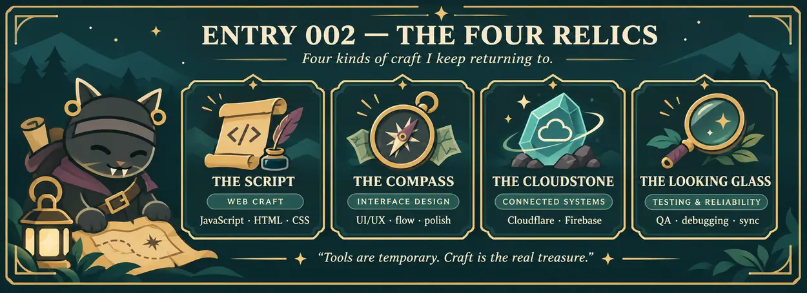
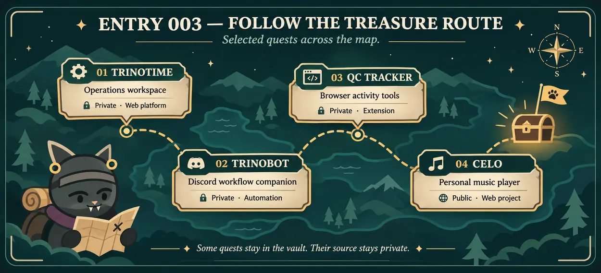

 

✦  THE PUMA'S FIELD JOURNAL  /  EST. IN CURIOSITY  ✦

### A developer's little corner of the internet.

*Building useful things. Collecting interesting problems. Leaving good code behind.*

**[↗ Enter the Portfolio](https://j-celo.github.io/My-Portfolio/)** &nbsp;·&nbsp; **[↗ Explore Public Repositories](https://github.com/J-Celo?tab=repositories)**

---

### ✧ ENTRY 001 — A NOTE FROM THE PUMA

I enjoy making technology feel a little more human. My favorite projects are the ones where **a good idea, careful engineering, and a clean interface** come together to solve a real problem.

From dashboards to browser extensions and Discord integrations, I'm interested in the whole journey: understanding the problem, building the solution, polishing the experience, and making it reliable enough to use every day.

<strong>📓 Open the field notes</strong>

 

- **Base camp:** Philippines
- **What I like making:** web tools, automation, thoughtfully designed interfaces
- **What I'm improving:** dependable integrations, performance, and clearer workflows
- **My process:** explore → build → test → refine
- **An important rule:** keep private projects and their data private

<strong>🧰 Inspect the inventory</strong> — Skills & technologies

**The Script:** JavaScript · HTML · CSS  
**The Compass:** UI/UX · interface flow · design polish  
**The Cloudstone:** Cloudflare · Firebase · connected services  
**The Looking Glass:** Quality assurance · debugging · synchronization

<strong>🗺️ Unroll the quest records</strong> — Read about the projects

**01 · TrinoTime** — A private operational workspace with attendance and team dashboards.  
**02 · TrinoBot** — A private Discord workflow companion for team commands and notifications.  
**03 · QC Tracker** — A private browser extension focused on tracking and synchronization.  
**04 · [Celo](https://github.com/J-Celo/Celo)** — A public personal music-player project.  
**Bonus · [My Portfolio](https://github.com/J-Celo/My-Portfolio)** — A public project showcase.

*Private projects are described only at a high level. No source code or confidential details are exposed.*

### ✧ ENTRY 004 — THE ADVENTURE RECORD

*The journey continues, one useful commit at a time.*

<strong>📈 View the activity trail and stats</strong>

Third-party services may occasionally be unavailable and do not necessarily include private work.

### ✧ LAST PAGE — THE CAMPFIRE

**[GitHub](https://github.com/J-Celo)** &nbsp; • &nbsp; **[Portfolio](https://j-celo.github.io/My-Portfolio/)** &nbsp; • &nbsp; **[LinkedIn](https://www.linkedin.com/in/jhan-roi-celo-5ab741407)**

 

*“A little curiosity, a little chaos, and a lot of building.”*

🐾 Plundering Puma · Treasure hunter by name, builder by nature.

<!--
This is an original GitHub profile layout built around a character dossier,
four invented inventory relics, an illustrated quest route, an activity trail,
and a campfire closer. It uses no third-party profile README layout template.
All private repositories remain private; only high-level project descriptions
are shown. The GitHub contribution-snake workflow is optional and not
embedded in the public README by default.
-->
