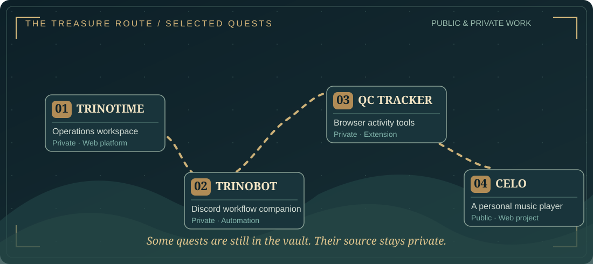
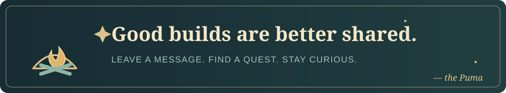

 

✦  THE PUMA'S FIELD JOURNAL  /  EST. IN CURIOSITY  ✦

### A developer's little corner of the internet.

*Building useful things. Collecting interesting problems. Leaving good code behind.*

**[↗ Enter the Portfolio](https://j-celo.github.io/My-Portfolio/)** &nbsp;·&nbsp; **[↗ Explore Public Repositories](https://github.com/J-Celo?tab=repositories)**

---

### ✧ ENTRY 001 — A NOTE FROM THE PUMA

I enjoy making technology feel a little more human. My favorite projects are the ones where **a good idea, careful engineering, and a clean interface** come together to solve a real problem.

From dashboards to browser extensions and Discord integrations, I'm interested in the whole journey: understanding the problem, building the solution, polishing the experience, and making it reliable enough to use every day.

<strong>📓 Open the field notes</strong>

 

- **Base camp:** Philippines
- **What I like making:** web tools, automation, thoughtfully designed interfaces
- **What I'm improving:** dependable integrations, performance, and clearer workflows
- **My process:** explore → build → test → refine
- **An important rule:** keep private projects and their data private

### ✧ ENTRY 002 — THE FOUR RELICS

Not just a wall of logos. These are the four kinds of craft I keep returning to.

**My working kit:** JavaScript · HTML · CSS · Cloudflare · Firebase · Git · GitHub · VS Code · Discord integrations

The tools change. **Making things useful, understandable, and dependable** is the part that stays.

### ✧ ENTRY 003 — FOLLOW THE TREASURE ROUTE

Every project is a different stop on the map. Some are open for exploration; others are kept in the private vault.

<strong>🗺️ Unroll the quest records</strong> — What are these projects?

 

**01 / TrinoTime — A workspace that brings things together.** A web-based environment for attendance, operational visibility, and clearer team workflows. Private source.

**02 / TrinoBot — A helpful companion.** A Discord integration that turns everyday commands into practical team workflow actions. Private source.

**03 / QC Tracker — Small tool, useful signals.** Browser-extension work focused on capturing activity and improving synchronization reliability. Private source.

**04 / [Celo](https://github.com/J-Celo/Celo) — A little something for the playlist.** A public personal music-player project.

**Bonus find / [My Portfolio](https://github.com/J-Celo/My-Portfolio)** — A public home for more of my work.

### ✧ ENTRY 004 — FOOTPRINTS IN THE FOREST

Some journeys leave tracks. Mine look a little like commits.

Publicly visible GitHub activity, rendered by an external service.

<strong>📖 Open the optional stats ledger</strong>

 

Third-party stats may be unavailable and may not count private work.

### ✧ LAST PAGE — THE CAMPFIRE

**[GitHub](https://github.com/J-Celo)** &nbsp; • &nbsp; **[Portfolio](https://j-celo.github.io/My-Portfolio/)** &nbsp; • &nbsp; **[LinkedIn](https://www.linkedin.com/in/jhan-roi-celo-5ab741407)**

 

*“A little curiosity, a little chaos, and a lot of building.”*

🐾 Plundering Puma · Treasure hunter by name, builder by nature.

<!--
This is an original GitHub profile layout built around a character dossier,
four invented inventory relics, an illustrated quest route, an activity trail,
and a campfire closer. It uses no third-party profile README layout template.
All private repositories remain private; only high-level project descriptions
are shown. The GitHub contribution-snake workflow is optional and not
embedded in the public README by default.
-->
